# docs/brand — the BadCode logo

**The red triangle in the ring, and a solid red o in the name. Kai, 2026-10-19: "I'm just going to say
that's our logo."** Bench save `2f6bogo164mzzi4lzz00` ("Saved version 5"). Kai kept the ring thickness,
the triangle, the name beside the ring, the solid o and the drawn letters ("it's very important that
we use the same font"). It replaces the 2026-10-15 save `b0dhojp15efdyw7rboj6` (ring 8%, o = ring +
triangle), which was canonical "for a minute". Files are in [`logo/`](./logo/). It replaces "The Look" of 2026-09-29 (the
same ring with a red **dot**), kept in [`archive/2026-09-29-dot/`](./archive/2026-09-29-dot/README.md);
the curly brace before that is in [`archive/2026-09-13-brace/`](./archive/2026-09-13-brace/README.md).

> **Answered, 15 October 2026:** the meeting's "red circle to a red triangle" ([`docs/misc/2026-10-15-meeting.md`](../misc/2026-10-15-meeting.md))
> turned out to be both: this mark (the triangle above) **and** the balaclava presenter's eyepatch.
> **Potential triangle designs (Jack, 2026-10-15):** twelve concepts in six versions, none picked,
> in [`design/research/2026-09-29-logo/triangle-round.md`](../../design/research/2026-09-29-logo/triangle-round.md)
> (images in its `sketches/triangle/`).

## What it is

**The icon:** a thin ring with one small red triangle inside it, off centre toward 2 o'clock, rounded
at the corners. It is the same character as the dot — something that has already seen how this ends
and is sizing you up — with an edge to it. It is also **the red-triangle eyepatch** worn by the
balaclava host of Money For Something (Kai, 2026-10-15), so the logo and BadCode-in-person are one sign.

**The name:** `badcode` in round lowercase, drawn from circles and straight stems (no font — the
"drawn letters" on the bench, and Kai wants this exact lettering everywhere), where **the o is a solid
red circle** the full size of the letters. A bare triangle as the o "reads as an A" (*badcade*, Kai
2026-10-15). The ring-with-triangle o of 2026-10-15 to 2026-10-19 is superseded by save 5.

## The rules

- **The triangle is never dead centre.** Off centre, it is a glance.
- **The o is always the solid red circle**, never a bare triangle (it reads as an a) and never a ring
  (a ring-with-a-dot o is close to Badoo's 2006–17 logo).
- **Always the drawn letters.** Never set `badcode` in a typeface; use the files.
- **Red is only ever the triangle and the o.** One small red thing per mark; never a red field.
- **Below 48px use the favicon files** — they carry a heavier line floor and a bigger triangle, or at
  16px it shrinks to a speck.

## The BadCode balaclava (Jack, 2026-11-03): every story, every time

Anyone in a BadCode balaclava, in any story or film, is BadCode in person. Jack: *"making the rule for all
balaclava usage to have the triangle over the right eye for all things we make with balaclavas so it is
consistent, also that there is no skin showing implying it could potentially be a robot like git push, but
no robot feature, just have gloves on and never show skin."*

- **The mask is the jeweller's-shop mask** (Colour Noir `mask1` b, Jack 2026-11-03: *"the masks are wrong they
  should be like the ones in [the jeweller's shop] with the triangle over the left eye and the white circle"*):
  a large **white ring** stitched round the whole face, and the **red triangle over the wearer's LEFT eye**,
  high inside the ring. Facing the camera, that puts the triangle on the **right of the picture**, at about
  2 o'clock, the same as the logo. (This replaces the "right eye" reading of earlier the same day.)
  Reference image (picked 2026-11-03): `Youtube Vids\animation\songs\bank robbery\gang\reference\lineup-a.jpg`, the six-man Bank Robbery gang facing camera.
- **Prompt wording:** paste [`balaclava/shared-wording.txt`](./balaclava/shared-wording.txt) verbatim (a variations round takes it as `shared.txt`, exempt from the sameness gate). 🔴 Never brief it as "a ring round the left eye": that reads as a small ring round one eye hole (Hello, I'm BadCode, 2026-11-12).
- **No skin, ever.** The balaclava has no eye, nose or mouth holes; its neck tucks into a collar; gloves on
  both hands; cuffs over the wrists. Nothing human shows, so it *could* be a machine underneath (the
  GitPush idea), but **no robot features**: no metal, no lights, no seams, no visor. Just cloth and gloves.
- **Mask colours and cloth are free** (they belong to the story's look.md): a different colour per gang member is
  fine. Fixed: the white ring, the triangle's eye, no skin.
- Applies to the Money For Something host as well as any gang. Prompt wording is the story's business; this is
  the rule, not a phrasing.
- **The triangle is the logo's triangle** (Kai, 2026-11-10: *"each of these anonymous individuals essentially is Bad
  Code. So, it's important that the triangle is in the right place"*): ONE solid red triangle with rounded corners,
  **inside** the white ring at its upper right, **pointing DOWN** (flat edge on top), about the logo's size relative to
  the ring. Never on the crown or on top of the ring, never pointing up or sideways, never two.

### Putting a balaclava in a picture: the procedure (Kai, 2026-11-10)

Flow does not hold the mask from words: the first look round of *The Rules* came back with small triangles pointing
up on top of the rings, and earlier Bank Robbery rounds centred it. So, every time:

1. **Reference, not just words.** Give Flow Jack's mask as an image: [`balaclava/mask-reference.jpg`](./balaclava/mask-reference.jpg)
   (the navy mask from the Bank Robbery music video, clip `gang/video/bg-y03-a-y03r8-a.mp4`, Kai: *"Jack has done a lot
   of work on getting the [balaclavas] looking good in there"*). New stills: generate, then run the fix pass below with
   this reference. Stage it under `~/.cache/` first (never upload from `/mnt`).
2. **Fix pass** (`flow_edit_image`): references = the still + `mask-reference.jpg`, **two at most** (with the logo as a
   third, Flow returned the logo file instead of an edit). "Using the first image, change only the balaclavas so every
   one is the same design as the mask in the second image…", keeping each mask's colour and everything else.
3. **Check by eye, zoomed** (crop the heads, compare with `logo/avatar-1024.png`): one triangle per mask, inside the
   ring, upper right, pointing down. Leftover triangles from the old version are common: a second edit pass removes
   them ("delete any extra red triangle on the crown or on top of the ring").
4. **Clips** start from a still that passed step 3. Check the masks again in the clip's frames.

## The settings (the source of truth)

Everything in `logo/` is generated from these by
[`scripts/brand/build-logo.mjs`](../../scripts/brand/build-logo.mjs) (`node scripts/brand/build-logo.mjs`,
uses the repo's `sharp`). Change them, re-run, never hand-edit an SVG. They are Kai's bench save
`2f6bogo164mzzi4lzz00` of 2026-10-19 14:40 ("Saved version 5") — on the bench it reads *"triangle ·
ring 15% · size 36% · 2 o'clock · round 55% · drawn letters · solid o"*. The bench is
[`design/research/2026-09-29-logo/tuner/`](../../design/research/2026-09-29-logo/tuner/index.html)
(live: https://claude.ai/artifact/4Tf8nXY8RmRokTevDQ7cWe — it has a Triangle / Dot switch; old dot
saves still load as the dot).

| Setting | Value | Meaning |
| --- | --- | --- |
| ring | `0.15` | ring line thickness, as a fraction of the ring's radius (0.08 on 2026-10-15; the dot logo's was 0.17) |
| tSize | `0.36` | triangle size: centre to corner, as a fraction of the ring's radius |
| tPush | `0.61` | how far off centre: 0 = centre, 1 = touching the rim |
| tAngle | `55°` | which way it sits, clockwise from 12 o'clock (about 2 o'clock) |
| tRot | `55°` | which way it points, clockwise from 12 o'clock |
| tRound | `0.55` | corner rounding, as a share of the most possible |
| red | `#cc2b37` | the triangle in the icon, and the o |
| lw | `0.30` | letter line weight, as a fraction of letter radius |
| tr | `0.26` | letter spacing, as a fraction of letter radius |
| ck | `0.35` | the c pulled toward the red o (was 0.42 on the dot logo) |
| the o | solid red circle | the bench's "Solid red o" style |
| letters | drawn | the bench's "drawn letters" — circles and stems, no typeface |

Ink is `#0a0a0a` on light grounds and cold off-white `#eef3f6` on dark; the ground is `#050607`.
The red never changes with the ground.

## Files

| File | Use |
| --- | --- |
| `badcode-mark.svg` / `-reversed.svg` | the icon alone, dark ring / light ring, transparent |
| `badcode-wordmark.svg` / `-reversed.svg` (+ `-2400.png`) | the name alone |
| `badcode-lockup.svg` / `-reversed.svg` | icon + name side by side — the everyday lock-up |
| `badcode-stacked.svg` / `-reversed.svg` (+ reversed `-2400.png`) | icon over name — sleeves, posters |
| `favicon.svg`, `favicon-16/32/48/180.png`, `favicon.ico` | the icon on its own near-black disc, so it reads on light and dark tab bars |
| `avatar.svg` / `avatar-1024.png` | profile picture on a near-black square, safe for a circle crop |

## Explorations (2026-10-21, none ruled)

Flow rounds and Jack's social-media variant, all in [`explorations/`](./explorations/). **None replaces save 5**;
that is Kai's call.

- [`2026-10-21-jack-variant/`](./explorations/2026-10-21-jack-variant/README.md) — red o + white triangle + outline,
  built in code; what Jack uses on every account. **Jack's right logos:** the two 4K files
  `badcode-logo-and-name-4K.jpg` and `badcode-logo-only-4K.jpg` there (2026-10-21).
- [`2026-10-21-sketch-shadow/`](./explorations/2026-10-21-sketch-shadow/README.md) — hand-drawn shadow; Flow redrew the letters.
- [`2026-10-21-styles/`](./explorations/2026-10-21-styles/README.md) — the logo in 13 scenes (dubplate, flyer, tattoo, placard, teletext…).
- [`2026-10-21-redesigns/`](./explorations/2026-10-21-redesigns/README.md) — 10 redesigns with the logo attached; all kept ring-over-word.
- [`2026-10-21-wild/`](./explorations/2026-10-21-wild/README.md) — 12 text-only redesigns; these broke the layout.
  Shortlist offered to Jack: w09 barcode, w06 red wedge, w11 swiss, r6 bc monogram, r9 one-line. No pick yet.

## Open

- **Jack's say** — the pick is Kai's (2026-10-19, no longer provisional); Jack (lead creative designer) has not seen it yet.
- **Checks before it goes public:** a UK IPO trade-mark search for ring-with-triangle device marks (and the old ring-with-dot)
  (classes 9, 41, 42); a look at Big Brother UK's 2001–2025 geometric eyes (the one near-miss the
  research could not see). Research and the clash checks: [`design/research/2026-09-29-logo/`](../../design/research/2026-09-29-logo/README.md).
- **Not yet on the website** (`apps/web` still has no favicon or logo).
- **Red for colour-blind viewers:** `#cc2b37` is darker than the brief's `#e6291c`, so red-blind
  viewers see it closer to the black ground. Logos are exempt from contrast rules; noted, not ruled.
